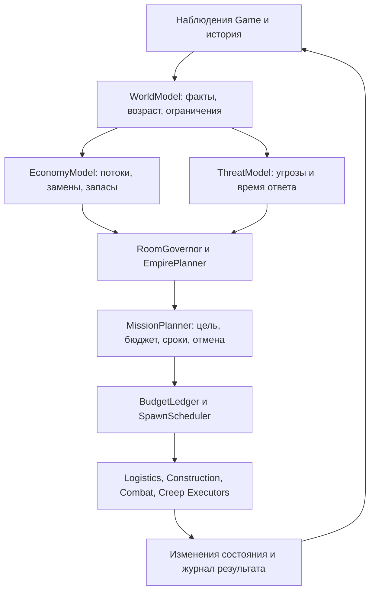

# Дизайн стратегии v1: устойчивый рост под военной угрозой

Статус: **предлагаемый дизайн для реализации**, не внедрённая стратегия. Задача [#15](https://github.com/Tarolrr/screeps/issues/15), 2026-11-07. Обоснования, источники и расчёты: [исследование](README.md), [приложение](calculations.md), [библиография](research.md). Все параметры ниже — конкретные начальные настройки для эксперимента. Они не объявляются оптимальными.

## 1. Цель, границы и главный алгоритм

Рабочая цель: увеличивать устойчивый чистый доход и число самодостаточных комнат, сохраняя способность восстановить домашнюю экономику и ответить на наблюдаемую угрозу. GCL — полезный долгосрочный результат свободной энергии. Цена атаки оценивается через собственную выгоду и риск, а не количество нанесённого урона.

Для v1 поддерживаются обычные комнаты, обычные creeps и unboosted экономика. Усиленные враги распознаются и учитываются в оценке угрозы, но автоматическая атака сложных укреплений, strongholds, power-bank операций, intershard и ядерной войны не входит в первый этап. Неподдерживаемый бой не считается безопасным. Это граница реализуемого первого релиза, а не утверждение, что такие угрозы отсутствуют.

**Порядок выбора ресурсов:**

1. Сохранить критическую функцию, которая будет потеряна раньше всего: защита последнего spawn, предотвращение downgrade, восстановление добычи/подачи энергии. Действия выполняются параллельно, если не конфликтуют за ресурс.
2. Обеспечить запланированные замены, обязательное снабжение обороны и минимальный ремонт до их сроков.
3. Довести резерв до целевого уровня и восстановить предсказуемость экономики; разрешены проекты, непосредственно снимающие текущий аварийный дефицит.
4. В нормальном состоянии сравнить допустимые проекты экономики, remote, колонизации и ограниченной атаки. Приоритет задаётся достижимым дополнительным результатом на горизонте и условиями риска; ниже дан точный порядок разрешения конкуренции с RCL.
5. Оставшуюся энергию направлять в выбранный RCL/GCL, ограничивая мощность улучшателей доступным потоком. Не создавать излишних работников только потому, что есть возможность оплатить тело.

Оборона до угрозы — ограниченный проект готовности; во время непосредственной угрозы — обязательство со сроком. Атака, устраняющая подтверждённую блокаду жизненно важного пути, может быть обязательной; дальний рейд ради выгоды остаётся необязательным проектом.

## 2. Архитектура и владение решениями

| Компонент | Вход | Выход и ответственность |
| --- | --- | --- |
| WorldModel | Game, Memory, факты последнего тика | Один снимок состояния; отсутствие видимости отдельно от отсутствия объектов |
| EconomyModel | Снимок, дельты потоков, роли, пути | Надёжный доход, дефициты мощностей, сроки замен, календарь затрат |
| ThreatModel | Наблюдаемые враги, укрепления, разведка | Класс угрозы, интервал времени опасности, допустимость боя/маршрута |
| RoomGovernor | Эти модели и текущие миссии | Режим комнаты, обязательные потребности, предложения проектов |
| EmpirePlanner | Состояния комнат, GCL, CPU, предложения | Межкомнатные миссии, помощь, допуск claim/remote/raid, резерв shard safe mode |
| MissionPlanner | Одобренный проект | План ресурсов и этапов; подтверждение прогресса, пауза, завершение/отмена |
| BudgetLedger | Имущество, обещания, ожидаемые доставки | Единственный владелец резервирования энергии и лимитов миссий |
| SpawnScheduler | Потребности со сроками и варианты тел | Единственная очередь на все доступные spawns комнаты |
| Исполнители | Назначенные задачи и ограничения | Intents и наблюдаемые результаты; не создают стратегические бюджеты |

Модули не вызывают друг друга циклически ради заказа крипов. Они формируют предложения; итоговый план проверяется и только затем выдаётся исполнителям. В течение тика каждый ресурс, тело и доставка имеет одного владельца назначения. Заказ не становится готовой мощностью до рождения и прибытия на рабочее место.

**Адаптация текущего бота:** основой первой интеграции выбрать `dist2`, поскольку там уже есть жизненный цикл ресурсов и заказов. Сохранить типы заказов как исполнительный слой, заменить генераторы фиксированных заявок на адаптер принятых потребностей. Исправить затрагивающие сценарий дефекты отдельно. `dist` оставить сравнительным baseline. Новая реализация может использовать те же контракты без resourceManager; публичные методы игры не меняются.

## 3. Минимальные контракты данных

Это логические интерфейсы; при реализации имена можно сохранить буквально. Энергия измеряется в energy, скорость — energy/tick, сроки — абсолютный Game.time. Серверные константы читаются из среды, не копируются из примеров.

| Объект | Обязательные поля и смысл |
| --- | --- |
| RoomSnapshot | room, tick, visibility, controller/rcl/downgrade, spawn и очередь, энергия по узлам, creeps с body/boosts/TTL, источники, маршруты, hostiles, CPU |
| IntelRecord | room, observedAt, owner/reservation, источники/terrain, видимые hostile body/boosts/towers/периметр; неизвестное хранится как unknown |
| Demand | stableKey, missionId, capability, amount, location, requiredBy, earliestStart, criticality, допустимые варианты тела/назначения |
| CandidateProject | id, type, dependencies, startCostUpper, recurringCostUpper, incomeLower, benefitDelayUpper, completionDeadline, spawnDemand, intelRequirements, scenarios |
| Mission | id, type, home/target, stage, createdAt, budgetTotal, spent, committed, deadline, objectives, abortConditions, observationVersion |
| Reservation | id, missionId, resource/node, amount, dueAt, исполнители/очередь, статус; при отмене освобождается только непотраченная часть |
| DecisionRecord | tick, mode, reasonCode, исходные показатели, альтернативы и причины отказа, выбранный проект, ожидаемый следующий факт |

Узлы энергии различаются физически: spawn/extensions, storage/containers, cargo, piles, remote. Сумма содержит каждую единицу один раз. Перенос между узлами не считается добычей. Обещание доставки — ссылка на существующую энергию/будущую добычу и конкретную транспортную мощность, не второй баланс.

История хранит агрегаты по 100 тиков и последние 30 таких окон на комнату; последние 100 значимых решений сохраняются кольцом. Профиль наблюдений: добыча, внешние поступления/убытия, spawn, build, repair, upgrade, defense, потери/decay, фактические рейсы и простои. Необъяснённая разница баланса помечает прогноз низкой достоверности и запрещает новые дальние инвестиции, но не аварийные действия.

BudgetLedger обрабатывает команды последовательно в одном тике. Свободно в узле = наблюдаемый остаток минус активные назначения этого узла; будущие поступления не дают права потратить энергию сейчас. Переходы Reservation: RESERVED → ISSUED → SETTLED; допускаются PARTIAL и RELEASED. ISSUED не означает расход: на следующем снимке он подтверждается фактической дельтой/событием по объекту и типу действия. Одно действие связано с одним reservationId; повторное подтверждение того же `(tick, actor, action, target)` ничего не списывает. Частичный результат списывает подтверждённое, остаток остаётся до срока или освобождается. Нельзя одновременно вычесть стоимость из наблюдаемого остатка и ещё раз считать её неснятым обещанием. При неизвестном исходе обещание остаётся спорным до сверки, новые расходы того же узла блокируются, кроме аварийного перепланирования.

При гибели груза/исчезновении энергии отменить непотраченные назначения в порядке raid → claim → новый remote → обычная стройка → обычный upgrade; критические обязательства переоценить, а не объявлять профинансированными. Доставка перемещает резервирование между узлами после подтверждения и не создаёт новую энергию. Квоты 50/50 начисляются из подтверждённого свободного притока каждые 25 тиков в два целочисленных счёта; нечётная единица достаётся резерву. Остатки переносятся, но не дублируются в балансах; отменённая цель возвращает остаток общему распределителю. Журнал счётов хранится в Memory и сверяется после reset.

Для существующего потока нижняя прогнозная оценка — минимум трёх последних завершённых окон по 100 тиков при неизменившейся топологии. При существенном изменении маршрута/состава статистика этого потока сбрасывается. До накопления истории используется 0,8 от аналитического ограничителя источника, роли и доставки; для известного сбоя затронутый поток равен нулю. Это инженерный запас, не статистический доверительный интервал. Для неопробованного remote применяется та же скидка и обязательный ограниченный пилот.

## 4. Частота решений и режимы комнаты

Наблюдение критических событий, исполнение, угроза, башни и safe mode — каждый тик. Пересчёт потребностей комнаты — каждые 25 тиков; пересмотр межкомнатных проектов — каждые 100, со смещением по имени комнаты. Смерть ключевого крипа, hostile, утрата маршрута, изменение RCL или разрушение объекта инициируют внеочередной пересчёт. При недостатке CPU сначала откладываются проекты и поиск новых путей; ранее выданные безопасные назначения и аварийный цикл продолжаются.

Режим не отключает другие жизненно важные действия; он ограничивает новые расходы:

| Режим | Условие входа, проверяется сверху вниз | Разрешённое поведение |
| --- | --- | --- |
| SIEGE | Наблюдаемый вооружённый противник угрожает домашней комнате либо повреждает критические объекты | Защита, снабжение, ремонт, восстановление; новые remote/claim/raid приостановлены |
| RECOVER | Нет действующей или успевающей к сроку цепи добычи и подачи в spawn; либо домашний spawn потерян | Дешёвый восстановительный пакет или внешняя помощь; обычный рост остановлен |
| ALERT | Вооружённая угроза на используемом маршруте/соседнем подходе, доступ похитителя к открытому запасу либо известный враг потерян из видимости | Отозвать уязвимых работников затронутого маршрута, разведать, обеспечить защиту; не расширять экспозицию |
| STABILIZE | Не обеспечен нижний резерв, просрочены критические замены или финансовый прогноз недостоверен | Восстановление покрытия обязательств; проекты устранения подтверждённого дефицита |
| GROW | Остальные случаи | Проекты и контроллер в пределах бюджета |

Возврат из SIEGE/ALERT — после 100 последовательных тиков без подтверждённой угрозы в собственной комнате и свежего повторного осмотра затронутого подхода. Исчезновение hostile из Game из-за потери видимости не очищает угрозу. Вход немедленный, выход с задержкой. Механическая блокировка единственного выхода дополнительно считается нарушением доступности маршрута.

Для определения SIEGE в v1 достаточно в собственной комнате наблюдать неразрешённого чужого крипа с активными ATTACK/RANGED_ATTACK, WORK для возможного dismantle или CLAIM для воздействия на контроллер, либо наблюдать враждебное повреждение критического объекта. Это намеренно широкий триггер, не заключение о победе врага. Такая же сила на рабочем внешнем маршруте даёт ALERT и закрывает именно этот маршрут. Посетитель без боевых частей и CARRY даёт запись разведки; фактическая блокировка критического прохода вызывает ALERT. Чужой CARRY не считается безвредным: доступ к открытому запасу в range=1 или к pile/pickup даёт локальный ALERT и защиту ресурса; наблюдаемая кража либо продолжающаяся попытка — враждебное экономическое действие. Одна только CARRY вдали от доступных ресурсов не вызывает SIEGE. Приоритет — закрыть доступ, перенести ресурс/маршрут и при возможности перехватить нарушителя. Башни вправе атаковать подтверждённого похитителя, если это не срывает более срочную защиту. Если атрибуция сомнительна, сохраняется UNKNOWN и назначается наблюдение/защита, а не выдуманное доказательство кражи. Неизвестная сила в актуальном сообщении об атаке считается вооружённой до осмотра; отсутствие вообще каких-либо сведений о далёкой комнате запрещает проект в неё, но не переводит весь дом в вечный ALERT.

Степень развития хранится отдельно: BOOTSTRAP (нет первого замкнутого контура), BASIC (контур есть, нет RCL3 с питаемой башней), BUFFERED (RCL4, storage и контролируемый баланс), NETWORKED (не менее двух самодостаточных комнат). Высокий RCL не мешает перейти в RECOVER.

## 5. Финансы и резерв

Планирование обязательств использует горизонт 1500 тиков. Для каждого срока рождения, доставки и ремонта строится датированный баланс. Сквозная проверка нужна в обычном сценарии и при потере последнего местного добытчика, последнего feeder, их совместной потере, отключении каждого remote и наблюдаемом рейде. Для события-сбоя сравнивается полный сценарий с заменёнными потоками и расходами; нельзя суммировать расход утраченного крипа и уже учтённую его замену повторно.

В момент нового необязательного платежа проверяются: достаточно ли сейчас физически доступной энергии, хватает ли средств/провозной способности на каждый последующий срок, существует ли допустимая цепь восстановления в сценариях. Доход от защищаемого remote не финансирует собственное аварийное восстановление, если рассматривается его потеря. Заявка на ещё не построенную инфраструктуру не считается доходом.

Нижний резерв — достаточный начальный доступный запас для **выбранных фиксированных планов** аварийных сценариев с текущими телами и путями, не глобальный минимум среди всех возможных стратегий. Целевой резерв рассчитывается тем же методом по дополнительным сценариям: в каждом базовом сценарии на первые 300 тиков обнулить поступления от remote, сохранив все обязательные платежи с их стабильными ключами ровно один раз. Цель — максимум нижнего резерва и дефицитов этих дополнительных календарей. Нельзя прибавлять повторно сумму расходов первых 300 тиков; наличие Reservation не влияет на уникальность платежа. Уже отключённый remote повторно не вычитается. Дополнительный сценарий совпадает с исходным только если все remote уже отключены; иначе остальные поступления remote тоже обнуляются на первые 300 тиков. При нехватке данных нижний резерв складывается из дешёвого восстановительного пакета и измеренных/верхних сроков, а не из максимальных штатных тел.

Расчёт v1: для каждого сценария применить сбой сейчас и отдельно в момент ближайшего срока замены затронутой функции. Взять действующие назначения; недостающую функцию восстановить первым допустимым аварийным шаблоном по правилу раздела 7, затем добавить обязательные замены на 1500 тиков. Календарь содержит события оплаты, рождения, прибытия, смерти, доставки, ремонта и смены скорости дохода; между событиями потоки постоянны. Начальный денежный дефицит равен максимуму префиксной суммы `расходы − поступления`, округлённому вверх. Для каждой оплаты отдельно проверять узел и ёмкость. Выполнить не более одного повторного построения после обнаружения задержки; не сошлось — UNKNOWN, необязательные миссии не запускать. Это конечная проверка пакета, без поиска неограниченного дерева действий. Достижимость и восстановление последнего spawn проверяются отдельно: энергия не компенсирует отсутствие исполнителя.

До storage целевой запас ограничивается реально доступной защищаемой ёмкостью. Если полное целевое покрытие невозможно, допускается BASIC-рост по обязательным вехам RCL и локальные проекты, уменьшающие дефицит; claim/raid и новые remote остаются закрыты. Это явное исключение, чтобы требование большого склада не заблокировало получение RCL4.

Приоритет этого исключения выше обычного запрета роста STABILIZE: оно действует только когда домашний контур жив, ближайшие критические замены обеспечены, нет SIEGE/ALERT, а единственная причина дефицита резерва — доступная ёмкость хранения. До заполнения этой ёмкости свободный приток делится 50/50 между запасом и нужной вехой; после заполнения весь свободный приток идёт в пакет вехи, увеличивающей ёмкость. При настоящем дефиците дохода/замен исключение не действует. BOOTSTRAP использует восстановительные назначения, которые вправе выполнять минимальный upgrade и стройку для следующего рабочего тела; не ждёт режима GROW для достижения RCL2.

Обязательные замены и восстановление могут расходовать резерв. Нельзя запрещать создание последнего перевозчика потому, что оно уменьшит страховой запас. После обычного spawn не требуется держать неизменные 200 в самом spawn каждый тик: проверяется вся цепочка доступности к сроку, включая уже создаваемого крипа. Необязательные расходы не должны делать эту цепочку невыполнимой.

Резерв ниже цели, но выше нижнего: 50% текущего свободного притока направлять на пополнение, 50% — на ближайшую веху или допустимый короткий локальный проект; при достижении цели долю пополнения обнулить. Ниже нижнего резерва весь свободный приток идёт на восстановление покрытия, кроме явно одобренного проекта, который устраняет сам дефицит. Эти доли относятся только к свободному притоку после обязательств, не ко всей добыче.

## 6. Экономика, RCL и расширение: конкретный выбор

### Вехи домашней комнаты

1. Замкнуть минимальную цепь добычи и доставки. Универсальный аварийный рабочий и специализированная пара — два проверяемых шаблона; выбирать самый быстрый достижимый первый возврат энергии, затем стоимость. При равенстве предпочитать универсального рабочего.
2. Обеспечить RCL2 и extensions только до стоимости выбранного следующего эффективного тела. Каждое расширение должно иметь потребителя мощности; не заполнять все строительные лимиты автоматически.
3. При недостаточной добыче/доставке рассмотреть локальный проект; при отсутствии короткой окупаемой возможности перейти к RCL3, башне и её снабжению. До питаемой башни и выхода из BOOTSTRAP начинать только домашние проекты и разведку.
4. Следующая обязательная веха — RCL4 и storage, если текущая ёмкость не позволяет сформировать рассчитанный резерв или ограничивает полезный поток. Если ограничения нет, RCL4 сравнивается как обычный пакет возможностей.
5. RCL5–8 рассматривать пакетами: уровень + нужная инфраструктура + обслуживание. Если новый уровень не снимает известное ограничение, дополнительный апгрейд использует оставшийся бюджет, а не вытесняет прибыльный проект.

### Сравнение проектов

Для каждого кандидата прогнозировать дополнительный **собственный** чистый результат против сохранения текущего поведения. Горизонт обычного сравнения — 10 000 тиков от текущего момента; для стартовой домашней экономики — 3000. Первоначальные расходы, будущие замены, снабжение и потери считать по одному календарю. Контроллерный прогресс не записывать одновременно и как сохранённую энергию, и как имущество. Военный трофей учитывать только в объёме, который можно доставить; разрушенную чужую энергию не считать доходом.

Упрощённый фильтр: `V = ΔnetLower × max(0, H − delayUpper) − startCostUpper`. Он допускается для первичного отбора, но утверждение миссии использует календарь, а не повторный вычет усреднённых стартовых затрат. Если эффект одноразовый, вместо скорости используется его нижняя оценка. Для проекта RCL оцениваются открываемые действия и цена всего пакета; неподтверждённая польза новой возможности равна нулю в экономическом сравнении, при этом обязательная веха безопасности сохраняет свой приоритет.

Выбор в GROW:

1. Обязательные вехи из списка выше получают текущий свободный поток, **кроме** следующего правила короткой инвестиции.
2. Локальный проект может отсрочить веху, если снимает измеренное ограничение, окупается не позднее 3000 тиков и расчёт времени **полного пакета вехи** с ним меньше, чем без него. Оба расчёта стартуют с одинаковым имуществом, резервом и мощностью WORK. Если веха успевает завершиться до запуска выгоды проекта, преимущество обычно остаётся у вехи; результат подтверждается расчётом, не правилом «всегда экономика».
3. После обязательных вех допустимые local/remote/claim/raid сравниваются по максимальному `V` на общем горизонте, после всех ограничений ниже. При `V ≤ 0` новый проект не запускается. При разнице ≤10% от большего положительного `V` выбирать меньший необратимый расход; затем более ранний результат; затем local → remote → claim → raid; затем стабильный ID.
4. Запустить не более одного нового капитального проекта на комнату за пересмотр, зарезервировать его ресурсы и пересчитать остаток. Уже идущий проект не вытеснять, если альтернативный не лучше минимум на 25% по **оставшейся** выгоде после переключения. Непосредственная угроза обходит это правило. Потраченные средства не являются основанием продолжать убыточный проект.
5. Для лучшего положительного проекта, который проходит все проверки кроме финансирования, включить накопление по следующему правилу. Только остаток после этого идёт в контроллер, если достаточно подачи и нет более раннего обязательства. При пустом списке положительных проектов энергия не накапливается бесконечно сверх целевого резерва.

**Фонд проекта:** одна копилка на домашнюю комнату, без расхода до полного допуска. Если пакет стоит K и ограничен долей p свободного капитала, для запуска нужен капитал Q=K/p. Копилка удерживает имеющийся безопасный капитал до Q и получает 50% нового свободного притока; остальные 50% идут в выбранный контроллер. До создания фонда рассчитать срок накопления `max(0,Q−F)/(0,5g)` при нижней оценке свободного притока g, включить его в задержку/цену отказа от RCL и повторно сравнить проект с альтернативами. При g≤0 или сроке накопления >3000 тиков фонд не создавать. Правило ближайшей обязательной вехи сохраняет приоритет.

Фонд помечен `SAVING`, ещё не FUNDED/EXECUTING. Во время проверки доли собственный фонд включается в F ровно один раз; обещания остальных миссий и аварийный резерв исключаются. При достижении Q пакет K резервируется миссии, Q−K освобождается; это капитал, а не стоимость проекта. Фонд пересматривается каждые 100 тиков, отменяется при угрозе, провале **нефинансового** допуска, неположительном V с учётом оставшегося накопления или истечении 3000 тиков. Недостаток средств до Q является ожидаемым состоянием SAVING и сам по себе не отменяет фонд; проверка FUNDED выполняется только при достижении Q. После runtime reset сохраняются исходный срок фонда и накопленная сумма, а промежуточная проверка на тике 100 при F=3500 должна продолжить накопление. При отмене средства освобождаются. Отменённый кандидат не открывает такой же фонд до появления нового факта (цена, доход, разведка, резерв, RCL), чтобы избежать бесконечного сброса таймера.

Проверочный пример: remote K=1000, p=0,25, F=3000, свободный приток g=10. Требуется Q=4000; 5/тик копятся, 5/тик идут в контроллер. Через 200 тиков пакет может стартовать, если повторная проверка проходит. Без фонда постоянный расход всего избытка в upgrade блокировал бы этот проект навсегда. Начальный F и деньги фонда не складываются повторно.

`V` — инструмент сравнения выбранных кандидатов, не универсальная функция победы. Для доступности новой комнаты возможна выгода после 10 000 тиков; в v1 такой проект откладывается и помечается `HORIZON_TOO_SHORT`. Горизонт можно увеличить профилем, но нельзя незаметно сравнивать один проект на 3000, а другой на 50 000.

### Допуск remote

Свежая разведка каждого участка маршрута не старше 500 тиков, нет известной вооружённой угрозы, домашний резерв обеспечен, текущая экономика прошла 1500 тиков без аварийного дефицита. Прогноз суммарной занятости домашнего spawn после добавления ≤70%; после сценария отключения remote все домашние критические сроки остаются достижимы. Средний CPU последних 300 тиков после прогноза добавления ≤75% лимита.

Счётчик стабильности начинается с первого подтверждённого рабочего цикла и обнуляется при аварийном дефиците; отсутствие истории не равно 1500 успешных тиков. CPU-прогноз добавления: для каждой новой роли число тел × максимум(0,2 CPU, наблюдаемый p95 исполнения этой роли), плюс 0,5 CPU на новую комнату и 2 CPU на дополнительное планирование/поиск путей. Это начальная инженерная оценка, уточняемая профилированием, не факт движка. До первой калибровки долгий pathfinding дробится/откладывается; admission дополнительно требует bucket≥5000, если сервер поддерживает bucket. При отсутствующем/неограниченном CPU контракте фиксируется отдельный режим среды и используется измеренный лимит времени тика, а не выдуманное число Game.cpu.

Первый пилот: один источник, один маршрут, не более одного нового remote на домашнюю комнату. Лимит начальных расходов — меньшая из величин «стоимость одного поколения утверждённых работников и необходимой минимальной инфраструктуры» и 25% свободного капитала. Если минимальный пакет не помещается, пилот не дробится на бесполезные тела, а откладывается. Длительность наблюдения — минимум 1500 тиков после первой доставки. Постоянное расширение разрешается при положительном операционном чистом потоке за последние 300 тиков пилота, соблюдении сроков замены и положительном пересчитанном V на общем горизонте от начала проекта. Операционный поток = доставленная энергия минус содержание, потери и резервирование на будущие замены; первоначальный капитал учитывается в V отдельно, один раз. Полная окупаемость первоначального пакета за первые 1500 тиков не требуется. Если цикл источника/рейса длиннее окна, окно расширить до целого цикла, а результат до его завершения считать UNKNOWN. Резервирование — отдельный проект с учётом таймера, не обязательный первый шаг.

### Допуск claim

Есть слот GCL, положительная оценка пакета, непрерывный разведанный путь и свободный лимит колонизации: одна незавершённая новая колония на империю. Домашняя комната находится в BUFFERED/NETWORKED, выполняет критерии CPU/spawn/резерва и не в ALERT/SIEGE. Полностью зарезервирован seed-пакет: claimer, строители/доставка, создание spawn, запуск местной экономики, защита и её снабжение до первой самостоятельной замены. Помощь идёт по отдельной миссии с ограничением 30% свободного капитала дома; при недостатке средств накопление продолжается.

Лимит 30% относится к **общему пакету claim**, включая начальные тела, все планируемые доставки и помощь до самостоятельности, а не к каждой очередной транзакции. Дополнительная дотация сверх утверждённого пакета требует отмены/пересмотра старого проекта и нового сравнения; переименование платежа не обходит ограничение. Фонд проекта раздела 6 обеспечивает накопление, поэтому требование полного финансирования не создаёт тупик.

`CLAIMED` не означает `SELF_SUFFICIENT`. Последний статус требует 1500 тиков без внешней дотации, своевременной замены всех критических функций и положительного собственного баланса после обслуживания. При провале бюджета/маршрута проект приостанавливает новые расходы, а уже живые работники получают безопасный план; повторные дотации не создаются автоматически.

## 7. Потребности, тела и логистика

Добыча задаётся как целевой поток источника с учётом регенерации, доступных мест и фактического цикла роли. Перевозка — через полный измеренный рейс с загрузкой, разгрузкой, fatigue и ожиданием. Улучшатели/строители — через выделенный поток энергии и действительную долю рабочих тиков. Их избыток не оправдывается только наличием строительных площадок.

Для каждой потребности генерируются варианты из допустимых шаблонов и бюджетов: минимальный аварийный, минимальный достаточный для потока, вариант для быстрого перемещения. Сравнение: сначала успевает ли к сроку, затем минимальная полная стоимость поддержания нужной мощности на горизонте, затем занятость spawn, затем размер тела. Роль должна поддерживать выбранный шаблон; например, удалять CARRY из текущего harvester dist2 без изменения поведения запрещено контрактом роли.

Очередь spawn сортируется по: аварийная критичность → ближайший последний срок запуска → минимальное время до первого полезного действия → стабильный ключ. Последний срок учитывает фактическую очередь, `3 × body.length`, путь и запас 25 тиков. До появления надёжной статистики пути использовать верхнюю модель fatigue +25%; после трёх окон — максимум измеренных последних пяти рейсов для данного тела/маршрута. Изменение пути сбрасывает оценку.

Если голова недоступна по энергии, обязательный заказ рассматривает уменьшенное тело или назначение уже живого рабочего; остальные допустимые заказы не блокируются, **если их запуск не срывает срок и финансирование критического заказа**. Необязательные запросы имеют срок пересмотра, а не бесконечную жизнь. Все spawns комнаты участвуют в одном расписании. Смена создаётся заранее; старый и новый могут перекрываться, но их мощность и энергия не должны учитываться дважды за одно рабочее место.

Если критические сроки конфликтуют, обычная сортировка применяется только после конечного разбора: для двух ближайших конфликтующих потребностей рассмотреть оба порядка, меньшие допустимые тела, переназначение имеющегося рабочего и имеющийся safe mode/внешнюю помощь. Варианты сравнить лексикографически по предсказанным потерям: последний spawn империи → собственный контроллер → остальные домашние spawns → домашний контур дохода → remote/прочее. Затем — число невыполненных сроков, стоимость восстановления, earliest useful result, stableKey. Помощь учитывается только при подтверждённом назначении. Если есть больше двух конфликтов, зафиксировать первый выбранный шаг и повторить на оставшихся; это ограниченная эвристика, не доказанный оптимальный scheduler. Неизвестный исход не считается спасением функции.

Локальная логистика — общий пул с назначением по срочности и прогнозному времени доставки; устойчивый remote закреплён за маршрутом. Работники не перехватывают друг у друга уже зарезервированную энергию. Невозможная/устаревшая задача освобождает назначение. Доставка аварийной энергии может уходить с частичным грузом; для обычного рейса допускается ожидание полного, но не дольше момента, когда ожидание нарушает срок потребителя. При одинаковых сроках — больше доставленной энергии на полный цикл.

## 8. Оборона: геометрия, время и достаточность

ThreatModel различает чужого разведчика, вооружённого рейдера, группу с лечением, осадную угрозу и unknown. По умолчанию не атаковать безоружного посетителя только за присутствие; учитывать доступ CARRY к запасам и наблюдаемые экономические действия по разделу 4; фиксировать его и защищать доступность узких проходов. Вооружённые неразрешённые creeps на домашней территории считаются угрозой. Белый список владельцев по умолчанию пуст и задаётся конфигурацией, а не предположением о дипломатии.

Для каждой критической точки — spawn, feeder, склад, контроллер — оценивается раннее время, когда враг способен нарушить её работу. Путь врага выбирается по самому слабому доступному направлению. Для прикрывающей конструкции грубая нижняя оценка времени пролома: `hits / max(ε, damageUpper − sustainableRepairLower)`. Ремонт ограничен энергией и одновременно исполняемыми действиями; башня не может в одном тике и стрелять, и полностью ремонтировать. Если достаточность ремонта или геометрия неизвестны, благоприятное время удержания не предполагается.

Время ответа = ожидание энергии и очереди + spawn + подход + развёртывание. Если оно с запасом 25 тиков превосходит время опасности, выбирать имеющиеся средства удержания и safe mode, а не надеяться только на новую армию. При конкуренции комнат за safe mode: сначала предотвращение потери последнего spawn империи, затем минимальное время до необратимой потери, затем большая стоимость восстановления. Решение централизованное, факт активации проверяется.

Башни выбирают один из взаимоисключающих режимов: совместная атака достижимой цели с положительной нижней оценкой результата после лечения; лечение критического защитника; ремонт удерживаемого прохода. При невозможности нанести значимый урон не тратить весь запас бесконечно: сохранить ресурс на выбранный план удержания, зафиксировать необходимость помощи/safe mode. Это не отменяет полезную атаку на более слабую цель из той же группы.

Для поддерживаемых unboosted боёв оценивать активные части, дистанции, порядок повреждения, лечение соседей, длительность подхода и энергию башен. Buffs/boosts читаются из Game и таблиц движка. Простой показатель «число боевых частей» недостаточен. Для неизвестного эффекта или неподдерживаемой геометрии результат оценки — UNKNOWN, что разрешает защиту/отход и запрещает дорогую инициативную атаку.

**Контракт CombatAssessment v1:** вернуть PASS/FAIL/UNKNOWN, planId, проверенные enemyPolicies, нижний остаток здоровья/TTL, верхний расход, достигнутую цель и причины. PASS означает «пройдено в заданной модели», не доказательство против любого противника. Защитные действия разрешены и при UNKNOWN; инициативный бой требует PASS и свежей проверки перед входом.

Минимальный поддерживаемый полевой бой: одна видимая комната с известным terrain, до трёх наших и трёх чужих обычных unboosted creeps, без чужой башни, стены/rampart на пути цели, power effects и массового rangedMassAttack. Более сложная ситуация возвращает UNKNOWN. Отдельный анализ удержания собственных укреплений остаётся консервативным расчётом времени, он не выдаёт PASS для наступления.

Оценщик выполняет короткий прогноз на 50 тиков для трёх собственных шаблонов: удержание выбранной клетки с фокусом, сближение с фокусом, дистанционное удержание range=3. Для каждого проверяет пять реакций врага: удержание; сближение к нашей самой повреждённой доступной цели; фокус нашего ближайшего боевого крипа; отход с лечением; дистанционное удержание range=3 с лечением. Выбор цели при равенстве — по ID, шаг — по кратчайшему допустимому пути с порядком направлений 1–8; healer лечит союзника с наибольшим абсолютным дефицитом hits в доступном радиусе, затем себя. Модель соблюдает фазу действий, range, fatigue, активные части и несовместимые intents из движка; её результаты обязательно сверяются отдельными engine-сценариями до допуска инициативной атаки.

PASS получает собственный шаблон, который во всех пяти реакциях достигает **заявленной промежуточной цели** (устранён блокирующий противник/доступна клетка прохода/подобран и вынесен трофей), не теряет свой обязательный отряд, сохраняет путь отхода и не менее 25% суммарных исходных hits. Выбрать минимальный верхний расход, затем больший худший остаток hits, затем порядок шаблонов выше. Невозможность выполнить цель за 50 тиков — FAIL для этой попытки; неизвестная механика/объект/подкрепление — UNKNOWN. Убийство быстрого отступающего врага не обещается, если в модели он уходит. Для длительной миссии промежуточные цели переоцениваются каждые 5 тиков и при изменении наблюдений; неподтверждённая цель за пределами прогноза не используется как доказательство успеха.

Период «каждые 5 тиков» означает сверку допуска и запрос обновления, а не безусловный сброс незавершённого расчёта. При неизменном fingerprint работа продолжается с прежнего блока. Завершённый PASS можно использовать во время следующего пересчёта, только если fingerprint всё ещё совпадает, сохраняется текущая видимость и не прошли 10 тиков с завершения PASS; первый расчёт без предыдущего PASS остаётся UNKNOWN до завершения. Несовпадение fingerprint немедленно аннулирует прежний PASS независимо от периода. Истечение его срока без нового результата запрещает инициативные действия; оборона/удержание и отход остаются доступными.

Перед выдачей PASS и перед каждым инициативным действием проверить **текущие** TTL, срок миссии и разведку: каждому обязательному бойцу должно хватать оставшихся тиков на моделируемую цель, выход/возврат и 50 тиков запаса. Модельные относительные сроки пересчитываются от текущего момента; прошедшие 8 тиков вычисления не возвращаются крипу. Если зависящий от времени эффект/таймер нельзя корректно пересчитать, оценка UNKNOWN. Проверки: стабильный долгоживущий отряд завершает расчёт на тике 8 без перезапуска на тике 5; отряд с истекающим TTL не получает PASS по старому снимку; действующий неизменный PASS допускается во время очередного обновления до своего expiry.

Прогноз не исчерпывает все действия противника. Его ограниченность покрывается пределом стоимости отряда, проверкой дома, наблюдением и прекращением миссии, а не словом «гарантированно». Для оценки подкреплений в v1 инициативная цель не допускается, если на ней или в соседней комнате есть наблюдаемый вражеский spawn либо устаревшие сведения не позволяют исключить такой spawn. Для открытой местности внешняя неожиданная армия остаётся остаточным риском; это отдельно входит в сценарий потери отряда и запрет расходовать домашний аварийный запас.

**Порядок и бюджет CPU.** Сначала исполняются критические наблюдения, готовые защитные/tower/safe-mode intents и аварийные назначения; только затем запускается необязательный боевой прогноз. Перед каждым блоком расчёта проверить запас до Game.cpu.tickLimit: оставить не менее max(2 CPU, 10% tickLimit). Бюджет оценщика на тик — min(2 CPU, 10% Game.cpu.limit), но не больше оставшегося свободного времени сверх этого запаса; при отсутствии бюджета новый расчёт — UNKNOWN; применимость предыдущего PASS проверяется отдельно. Один блок содержит не более 10 модельных тиков, всего за игровой тик — не более 100 (750 модельных тиков могут завершиться за 8 игровых тиков при достаточном CPU). Каждый вызов PathFinder ограничен maxOps=200 и включён в тот же бюджет; неполный путь не считается доступным. Прогноз возобновляемый, но живёт не более 10 игровых тиков. При недостатке времени/неполном расчёте **новый расчёт** остаётся UNKNOWN. Эффективный допуск может использовать только ранее завершённый PASS при всех условиях его действительности из предыдущего абзаца; без него инициатива запрещена. Защитные действия продолжаются.

Результат привязан к fingerprint наблюдений (позиции, body/hits/boosts, структуры, энергия башен, terrain, абсолютные сроки смерти Game.time+TTL; штатное уменьшение TTL само по себе не меняет fingerprint). Изменение соответствующего факта немедленно аннулирует PASS и прерывает расчёт по старому снимку. Сценарии на разных снимках нельзя объединять в один PASS. Часто меняющийся противник может сделать прогноз невычислимым; тогда допустимы удержание, отход и разведка. При сервере без CPU API используются явный лимит модельных шагов и наблюдаемый wall deadline; отсутствие измеримого лимита не разрешает неограниченный прогноз. Эти ограничения уменьшают риск исчерпания CPU, но не доказывают успешное выполнение уже аварийно исчерпанного тика.

Первичная готовность после RCL3: работающая башня, путь её пополнения, возможность восстановить feeder, защищаемые критические клетки. Цель запаса башни в спокойном режиме — полная штатная вместимость; при ALERT/SIEGE снабжение приоритетно до плана боя. Нельзя автоматически ремонтировать все стены до одинакового максимума. Целевые hits рассчитываются из нужного времени ответа; после исчерпания наблюдаемой угрозы дорогое наращивание прекращается.

## 9. Атака как ограниченная миссия

V1 допускает три цели: снять блокаду своего маршрута, уничтожить наблюдаемых рейдеров, выполнить экономически оправданный рейд по разведанной неукреплённой цели. Осадные действия против укреплённой комнаты не запускаются без отдельного расширения модели боя и испытаний. Способность сформировать боевое тело ещё не означает разрешение на миссию.

Обязательные условия инициативного рейда:

- Домашняя экономика и оборона проходят сценарий ответного рейда после отправки отряда; никто из критических работников не переименовывается в бойца ради этого.
- Разведка цели не старше 50 тиков, маршрута — 500; перед фактическим боем нужна текущая видимость. Достаточно TTL для пути, цели и возвращения; +50 тиков запаса.
- Оценщик поддерживает этот бой и даёт положительный исход при верхней оценке видимых сил врага, лечения, возможного пополнения из наблюдаемых spawns и заранее заданном сценарии подкрепления. Неизвестный вражеский spawn рядом исключает уверенную оценку, пока не разведан.
- Нижняя собственная выгода положительна после расходов и лучше допустимого мирного проекта по правилу раздела 6. Польза снятия блокады учитывается как восстановленный собственный поток; политическая «месть» не имеет положительного числа по умолчанию.
- Бюджет одной инициативной миссии ≤20% свободного капитала и ≤5000 энергии на первый отряд; учитываются потеря тел, логистика и прогноз ответной защиты. Миссия, минимальный достаточный состав которой дороже, откладывается. Лимит 5000 — стартовая граница v1, не предел игры.

Одновременно разрешён один инициативный рейд на империю. Планируемое окно выполнения цели — до 1500 тиков от выхода отряда; на момент выхода его оставшийся TTL должен покрывать конкретный путь, действия и отступление. Автоматических бесконечных волн нет. Разрешена одна заранее профинансированная волна; новая требует нового сравнения проектов и действующего лимита.

Отступление/отмена: домашняя комната перешла в SIEGE/RECOVER; бюджет исчерпан; разведка показывает неподдерживаемое усиление или укрепление; безопасного пути возврата нет; оставшийся TTL не покрывает возврат +50; цель не приближается 100 тиков при доступной видимости. «Нет прогресса» измеряется по цели: восстановленный проход, изменение угрозы, доступность добычи/трофея, а не произвольный нанесённый damage. Если отступление невозможно, CombatExecutor выбирает локальное сохранение живых сил и отмечает невозможность, а не обещает безопасный выход.

Повторные набеги одного владельца увеличивают приоритет разведки и расчёта защиты/устранения угрозы. Они не автоматически разрешают бесконечную войну. История контактов сохраняет подтверждённые события, не ярлык «всегда агрессивный». Это практическое применение неполной информации и повторяющегося взаимодействия; теоретическое равновесие неизвестных ботов не вычисляется.

## 10. Жизненный цикл миссии и восстановление после сброса

Состояния: PROPOSED → SCOUTING → FUNDED → EXECUTING → VERIFYING → COMPLETED. Дополнительные: PAUSED и ABORTED. Локальный проект с достаточными данными пропускает SCOUTING. FUNDED означает реальные резервирования, не только наличие числа в Memory. Исполнение начинается после проверки зависимостей и повторной проверки безопасности.

После сброса runtime планы читаются из Memory, фактические объекты и живые задания сверяются по stableKey и missionId. Уже созданный крип не заказывается повторно; исчезнувшее обещание не остаётся занятым навсегда. Нельзя отмечать успех только по возврату OK. Стройка завершена по существующей работающей структуре, добыча — по доставленному потоку, raid — по своей заявленной цели, новая колония — по критерию самостоятельности.

PAUSED сохраняет цель и потраченный бюджет, освобождает будущие отменяемые обещания, назначает безопасные задачи живым работникам. Повторный запуск проходит допуск заново. ABORTED окончателен для конкретной попытки; повтор требует нового missionId и видимой причины. После любого провала обновляется оценка задержки/расхода, а исходная неудача остаётся в статистике.

## 11. Разобранные решения

**Экономика или контроллер.** Свободный поток 5/тик, цена проекта 500, накопление 100, внедрение 50, прирост 2. До цели 5000 выгоден проект: примерно 829 вместо 1000 тиков. До цели 100 выгоден немедленный апгрейд: 20 вместо 120. Это одно правило расчёта, а не две противоречащие рекомендации. Ценность открытой инфраструктуры и её цена добавляются в пакет, если цель — RCL-веха.

**Экономика или remote.** После резервов и обязательств свободны 20 000; горизонт 10 000. Локальный проект стоит 1000, даёт чистые +2 после 100 тиков: предварительно V=18 800. Remote стоит 3000, даёт чистые +3 после 500: V=25 500. При выполнении одинаковых ограничений remote выигрывает; если разведка устарела, его нельзя утвердить и выбирается local либо недорогая разведка, способная изменить выбор. Если полная обязательная веха завершается раньше с local, действует правило вехи. Значения придуманы для демонстрации алгоритма, не получены из текущего сервера.

**Расширение или оборона.** Враг доберётся до незащищённого feeder за 40 тиков, защитник появится через 60 и дойдёт ещё за 20. Новая оборонная заявка сама не решает угрозу: отвести feeder/обеспечить прикрытие текущими силами, проверить safe mode, приостановить remote. Денежная прибыль удалённого источника не отменяет этот дедлайн.

**Атака или развитие.** Рейд стоит 3500 и в лучшем случае наносит врагу 10 000 ущерба. Собственная гарантированная выгода не установлена, ответный риск неизвестен: V не становится положительным от чужого ущерба, миссия отклоняется. Если разведанный ограниченный удар устраняет повторяющуюся блокаду с подтверждённым потерянным собственным доходом и поддерживаемым боем, рассчитывается V восстановления этого дохода; при прохождении домашних ограничений он может выиграть у экономического проекта.

**Кому отдать последний spawn.** Защитник нужен через 60 тиков, а последний добытчик умрёт через 30; обе заявки не помещаются. Планировщик не просто применяет «defense выше economy»: проверяет запас на паузу добычи, возможность перераспределить рабочего, текущую оборону и safe mode. Выбирается допустимый вариант сохранения критических функций; если такого нет, журнал фиксирует неизбежную потерю и выбирает защиту последнего spawn/контроллера, затем минимальную стоимость восстановления. Невыполнимость не скрывается перестановкой очереди.

## 12. Начальные настройки и измерение

| Параметр | Начальное значение |
| --- | --- |
| room/empire reconsider | 25 / 100 тиков + критические события |
| История потоков / осторожная оценка | 30 окон ×100; минимум последних трёх |
| Модель без истории | 0,8 аналитической мощности, 0 при известном отказе |
| Обязательства / обычные проекты / bootstrap проекты | 1500 / 10 000 / 3000 тиков |
| Дополнительный сценарий целевого резерва | Первые 300 тиков без поступлений remote; уникальные платежи |
| Предельная загрузка spawn/CPU для нового расширения | 70% / 75% |
| Bucket для нового расширения, если поддерживается сервером | ≥5000 |
| Фонд положительного проекта | 50% свободного притока, срок ≤3000 тиков, один на комнату |
| Выход из тревоги | 100 тиков + повторный осмотр |
| Разведка route / attack target | ≤500 / ≤50 тиков |
| Запас запуска смены / возврата армии | 25 / 50 тиков |
| Улучшение для переключения проекта | 25% оставшейся выгоды |
| Лимит remote / claim / raid от свободного капитала | 25% / 30% / 20% |
| Инициативный отряд / параллельные raid | ≤5000 энергии / 1 |
| Полевой оценщик v1 | 3×3 creeps, 50 тиков, 3 своих шаблона ×5 реакций |

Для rollout сравнить текущую политику, простой baseline с фиксированными долями и этот проект. Не подгонять параметры после просмотра только удачных сценариев. Варьировать скидку дохода 0,6/0,8/1,0, покрытие 150/300/600, предел spawn 60/70/85%, горизонт 3000/10 000/30 000. Цель — показать область устойчивости и цену консерватизма, а не выбрать один красивый запуск.

## 13. План реализации и приёмки

**Этап A — наблюдение и финансовая модель.** Ввести снимок, календарь обязательств, учёт реальных дельт и теневой журнал решений. Старый бот ещё исполняет действия. Выход: модель объясняет баланс; назначения не дублируют энергию; UNKNOWN виден. Не менять одновременно экономическую политику и все роли.

**Этап B — жизнеспособность и оборонный минимум.** Режим восстановления, сроки замены, перебор доступных тел, обслуживание downgrade, обнаружение врага, управление питаемой башней и проверенный safe mode. Выход: на одноразовых сценариях потеря каждой критической роли и их пары обрабатывается либо восстановлением, либо корректным распознаванием отсутствующей предпосылки. Ошибки исполнения, мешающие этим сценариям, исправляются отдельными задачами.

**Этап C — домашний выбор экономики/RCL.** Общие бюджеты, реальные мощности, инвестиционные пакеты, динамическая логистика и стройка. Выход: воспроизведены случаи выигрыша короткой инвестиции и выигрыша близкой вехи, нет воспроизводства простаивающих необязательных ролей, резерв не блокирует аварийную замену.

**Этап D — разведка, remote, помощь и claim.** Сначала пилот одного remote, затем доказанное снабжение другой комнаты и лишь затем claim. Выход: закрытие пути останавливает расходы, потеря remote не разрушает дом, счётчик дотаций ограничен, самостоятельность новой комнаты подтверждена полным циклом замен.

**Этап E — ограниченная атака.** Поддерживаемый оценщик боя, бюджет одной миссии, свежая разведка, прекращение по условиям. Выход: превосходящая/неизвестная сила и вражеская башня отклоняют рейд; достаточный отряд выполняет ограниченную цель; подкрепления врага вызывают пересмотр; домашняя тревога отзывает доступные силы и запрещает новые расходы.

| Сценарий | Обязательная проверка |
| --- | --- |
| Старт с 300, без creeps/Memory | Первый достижимый цикл; отсутствие ожидания недоступного большого тела |
| Полный storage, нет feeder, пустой spawn | Различение имущества и ликвидности; действительный план восстановления |
| Смерть добытчика/feeder/обоих, в том числе при занятом spawn | Доступное тело, расписание, восстановление; отслеживание ошибок модели |
| TTL совпадают у нескольких ролей | Очередь не обещает невозможную одновременную замену |
| Мало до RCL / большая дистанция до RCL | Разные решения по одному расчёту, одинаковое начальное имущество |
| Дорога против изменения тела | Сравнение альтернатив, корректная цена стройки и содержания |
| Положительный remote K=1000 при F=3000 и g=10 | Фонд достигает порога 4000 за 200 тиков; капитал не удваивается и не уходит целиком в upgrade |
| STABILIZE только из-за ёмкости до storage | Допустимая веха продолжает получать бюджет; реальный дефицит замен всё ещё блокирует рост |
| Падение/восстановление remote, потеря видимости | Безопасность не выводится из отсутствия Game.rooms; нет бесконечных расходов |
| Безоружный scout / CARRY-похититель / рейдер / healer group / unknown boost | Различимые классы угроз и пределы оценщика |
| Башня пуста, safe mode недоступен, оборона опаздывает | Не объявлять защиту достаточной; удержание/отход/помощь |
| Две комнаты запрашивают safe mode | Один владелец решения, проверка результата, альтернативный план второй комнаты |
| Убыточная атака и появление подкреплений | Прекращение миссии без автоматической второй волны |
| Runtime reset в каждом состоянии миссии | Без повторной оплаты, двойного заказа или потерянных резервирований |
| CPU перегружен, противник меняет позиции каждый тик | Критические intents исполняются до прогноза; лимиты соблюдены, неполный новый расчёт не становится PASS; предыдущий завершённый PASS применим только до expiry и при неизменных фактах |
| Один платёж 600 на тике 200, нулевой доход, нет remote | Нижний и целевой резервы 600, а не 600+600; статус Reservation не меняет результат |
| SAVING на промежуточном тике 100 и после reset | При F=3500 фонд продолжает копить до Q=4000; исходный deadline не обновляется |
| Remote ещё не вернул стартовый капитал, но операционно прибыльный | Пилот оценивается по операционному потоку и общему V, без требования окупиться за одно поколение |

Эксперименты — только на одноразовых изолированных серверах по существующему протоколу проекта. На каждой конфигурации сохранить несколько карт/начальных фаз, полный ряд событий, неуспешные запуски и единый горизонт; среднюю скорость сравнивать вместе с потерями и временем восстановления. Непройденная техническая проверка — ошибка/UNKNOWN, не стратегический проигрыш и не PASS. Для соответствующих сценариев использовать/доработать результаты #12–#13, не объявляя их завершёнными этим документом.

Вводить политику по одной комнате через явный выбор `legacy | shadow | adaptive-v1`; это предлагаемый интерфейс будущей реализации. По умолчанию до приёмки `legacy`. При переключении исполнительные заказы сверяются и имеют ровно одного владельца; неизвестная версия Memory запрещает новые необязательные миссии и включает совместимый аварийный путь, а не стирает весь мир/Memory. Политика adaptive-v1 не включена настоящей исследовательской задачей.
