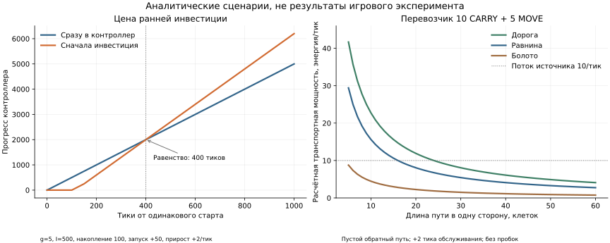

# Стратегия Screeps: рост, устойчивость и противник

Исследование по [задаче #15](https://github.com/Tarolrr/screeps/issues/15), 7 ноября 2026. Исходный код: `e2ce4054edf73cecdd179c9568aafe72b3edf27a`. Проверены действующие цепочки `dist` и `dist2`, документация игры и установленный движок. Это исследование и проект будущей стратегии; игровая эффективность предложений пока не измерена.

**Главный вывод:** управлять нужно будущей работоспособностью и полезным потоком энергии, а число крипов и уровень контроллера использовать как средства. Расширение должно увеличивать доход с учётом поддержки; оборона — обеспечивать время для ответа; атака — иметь достижимую цель, финансирование и правило остановки. Фиксированного универсального порядка «экономика → расширение → оборона → атака» нет. В [дизайне](DESIGN.md) этот выбор задан конкретным алгоритмом, состояниями и начальными параметрами.

## Как читать результат

| Материал | На какой вопрос отвечает |
| --- | --- |
| Этот документ | Почему так выбирать; подробный разбор компромиссов |
| [DESIGN.md](DESIGN.md) | Что реализовать: архитектура, бюджеты, приоритеты, миссии, проверка |
| [ARCHITECTURE.md](ARCHITECTURE.md) | Архитектура приложения: модули, фазы тика, контракты, Memory, ошибки, сквозная трасса |
| [INTEGRATION.md](INTEGRATION.md) | Фактические точки dist2, изоляция shadow, миграция владельца и откат |
| [RUNTIME-CONSTRAINTS.md](RUNTIME-CONSTRAINTS.md) | Что гарантирует и чего не доказывает runtime; границы учёта эффектов |
| [ARCHITECTURE-REVIEW.md](ARCHITECTURE-REVIEW.md) | Независимая проверка архитектуры и готовность к этапу A |
| [code-audit.md](code-audit.md) | Какие стратегические решения уже принимает твой код |
| [calculations.md](calculations.md), [скрипт](calculations.py), [JSON](calculations.json) | Откуда получены числа и при каких предпосылках |
| [research.md](research.md) | Документация, исследования, теория игр и ограничения переноса |
| [review.md](review.md) | Что проверено, независимое ревью и оставшиеся ограничения |
| [Повторное критическое ревью](critical-review-2026-11-08.md) | Контрпримеры, найденные 8 ноября, исправления и границы готовности |

В тексте различаются факт механики, факт кода, аналитический пример и предлагаемое правило. Значения по умолчанию в дизайне — стартовая проверяемая политика, не найденный оптимум и не приписанные владельцу предпочтения. Исходная беседа не выбрала единственную цель; после запроса конкретного дизайна принят рабочий профиль **«устойчивый рост при наличии противника»**. Он сохраняет возможность позднее настроить степень риска.

## 1. Быстрое развитие и запас прочности

### Что на самом деле конкурирует

Энергия, оставленная в резерве, сегодня не становится новым рабочим, инфраструктурой или прогрессом контроллера. Но она сохраняет возможность действовать завтра. Это особенно важно в Screeps: отсутствие одного звена может остановить всю цепь «источник → доставка → спавн → замена работников».

У резерва есть три разные функции:

1. **Оборотные средства:** оплатить уже известную следующую замену, не ожидая, пока умрёт действующий рабочий. Это предсказуемый расход, а не страхование.
2. **Аварийный запас:** восстановить минимальный работающий контур после потери части экономики.
3. **Военная готовность:** обеспечить защиту и её снабжение до прибытия помощи или окончания боя.

Складывать три независимых «запаса» без учёта общих расходов нельзя. Если один и тот же перевозчик одновременно восстанавливает доставку и кормит башню, его тело оплачивается один раз. Если сценарий требует двух независимых маршрутов, одного тела уже недостаточно. Нужен календарь расходов и доставок, а не процент от суммы на складах.

### Энергия в комнате и энергия, доступная для решения

Спавн оплачивает тело из доступных ему spawn/extensions. Склад и контейнер требуют работающей цепочки переноса. Поэтому 50 000 в storage и ноль переносчиков могут означать меньшую немедленную способность восстановиться, чем 200 в спавне при открытом источнике. Механизм пассивного пополнения spawn в стандартном движке может помочь при низкой энергии комнаты, но это медленный отдельный путь, зависящий от живого собственного spawn; его нельзя путать с готовым резервом. [Создание крипов](https://docs.screeps.com/creeps.html), [обработка spawn в движке](https://github.com/screeps/engine/blob/master/src/processor/intents/spawns/tick.js).

Доступность нужно задавать сроком: «сейчас», «до следующего рождения», «до гибели последнего добытчика». Энергию в пути учитывать один раз, с временем прибытия и живым исполнителем. При перекрытии маршрута она перестаёт быть надёжным источником финансирования.

Пример минимального запуска: `WORK+CARRY+MOVE` стоит 200 и способен самостоятельно собирать и доставлять энергию при соответствующей роли. Разделённая пара `WORK+MOVE` и `2 CARRY+MOVE` стоит 300; у неё иные производительность и время запуска, но есть зависимость между двумя исполнителями. Универсальный рабочий может быть подходящим аварийным вариантом, даже если в обычном режиме специализация выгоднее. Эти тела не являются гарантией восстановления при заблокированном источнике, уничтоженном спавне или неподходящей реализации роли.

### Как рассчитывать достаточность

Для сценария сбоя `s` и каждого срока `t` на горизонте восстановления проверяем:

`начальный доступный запас + гарантированные поступления до t − обязательные расходы до t ≥ 0`.

Нужный начальный запас для фиксированного плана — максимальный накопленный дефицит на этом горизонте; это не поиск глобального минимума среди всех стратегий. Расходы включают выбранную цепь восстановления, поддержку контроллера, ремонт критического прохода и защиту, если этого требует сценарий. Поступления от уничтоженного источника, будущего неоплаченного крипа или закрытого маршрута равны нулю. Дополнительно проверяются вместимость spawn/extensions, очередь спавна, проходимость и сроки жизни. Положительный энергетический баланс без этих проверок недостаточен.

В v1 достаточно нескольких сценариев: потеря одного добытчика, последнего перевозчика спавна, одновременная потеря добытчика и перевозчика, отключение remote и локальный рейд. Для выбранного профиля запас покрывает худший из допустимых сценариев, а не сумму всех несовместимых катастроф. Потеря единственного спавна рассматривается отдельно: внутреннее восстановление требует уже существующего строителя; иначе нужна внешняя помощь.

Пример в приложении: 300 ликвидных единиц для старта и запаса плюс 700 на добытчика и 750 на перевозчика дают 1750. Это иллюстрация расчёта пакета при наличии нужных extensions, а не универсальная цель накопления. Для маленькой комнаты пакет должен быть меньше и состоять из доступных тел. Для осаждённой комнаты он будет совсем другим.

### Цена резервирования

Если чистый свободный поток равен 5 энергии/тик, накопление дополнительных 750 задерживает расход этой энергии на контроллер на 150 тиков. Это не постоянная потеря 750: запас остаётся активом и может быть использован позднее. Но если эти же 750 могли раньше открыть новый поток дохода, цена задержки увеличивается. Именно поэтому «чем больше запас, тем лучше» не является стратегией.

Резерв полезен, когда он предотвращает конкретный дорогой или необратимый исход. Увеличивать его после насыщения выбранных сценариев обычно менее полезно, чем снять следующий дефицит. С другой стороны, правило «потратить всё, пока тихо» не учитывает старение крипов, очередь spawn и отсутствие информации о соседях.

**Предлагаемое решение:** нижний аварийный предел, целевой запас и отдельные оплаченные обязательства. Ниже нижнего предела прекращаются новые необязательные проекты; аварийные действия вправе его расходовать. Между пределами часть свободного потока пополняет резерв. Выше цели накопление само по себе не имеет приоритета. Переходы используют разные пороги входа и выхода, чтобы колония не меняла решение каждый тик.

## 2. Экономика и прогресс контроллера

### Считать чистый доставленный поток

У обычного собственного источника теоретический средний предел — 10 энергии/тик. Два источника дают потолок 20, но это ещё не бюджет развития. Из него вычитаются потерянная энергия, доставка, воспроизводство населения, обслуживание и защита. Внутреннее перемещение со склада к контроллеру не является новым доходом.

Для текущих схем `dist2` при двух источниках формируется до 11 постоянных заявок: два добытчика, шесть перевозчиков, два улучшателя и строитель. При максимальных телах это 8000 энергии за поколение, или **не менее 5,33 энергии/тик на замену** в упрощённом расчёте `8000/1500`. Даже при идеальных 20/тик остаётся не более 14,67 до иных расходов. Два улучшателя с суммарными 18 WORK не смогут постоянно получать 18/тик одновременно с оплатой такой замены. Больший размер улучшателя сам по себе не ускоряет развитие — он может лишь увеличить простой. [Действующие заявки](code-audit.md), [таблица тел и расчёты](calculations.md).

На бюджете тела 550 расчётный цикл действующей роли добытчика даёт примерно 14/тик с двух источников, а нижняя оценка замены 11 тел — 3,4/тик. В игре будут дополнительные ограничения; это уже показывает, почему фиксированные количества работников нельзя оценивать отдельно от энергетического баланса.

### Особенность твоей роли добычи

В движке 5 WORK при непрерывной работе достаточно для 10/тик. Но роль `dist2` после заполнения 50 CARRY тратит отдельный тик на drop. У 5 WORK получается цикл пяти тиков добычи и одного сброса: около 8,33/тик. У 6 WORK пять тиков добычи дают 60 энергии с учётом выпавшего переполнения, затем тик сброса: до 10/тик. Следовательно, шестой WORK нельзя автоматически назвать лишним. Можно менять тело и способ разгрузки совместно; отдельное уменьшение WORK способно снизить доход. [Роль](../../dist2/role.harvester.js), [переполнение при harvest](https://github.com/screeps/engine/blob/master/src/processor/intents/creeps/harvest.js).

Это пример важного принципа: инвестиция оценивается по фактическому циклу работы, а не сумме номинальных частей тела.

### Когда инвестиция обгоняет прямой апгрейд

Сравним две политики с одинаковым начальным свободным запасом, равным нулю. Общая экономика после содержания даёт 5/тик. Инвестиция стоит 500, внедряется за 50 тиков после оплаты и затем приносит дополнительные чистые 2/тик. Резерв выживания уже обеспечен, мощность улучшателей достаточна.

Прямая политика немедленно улучшает контроллер. Инвестиционная сначала 100 тиков копит 500, затем возобновляет обычный апгрейд; дополнительный доход появляется с тика 150.

| Горизонт | Прямой апгрейд | Инвестиция, затем апгрейд | Выигрыш инвестиции |
| ---: | ---: | ---: | ---: |
| 100 | 500 | 0 | −500 |
| 200 | 1000 | 600 | −400 |
| 400 | 2000 | 2000 | 0 |
| 1000 | 5000 | 6200 | +1200 |

Цель 5000 достигается за 1000 тиков напрямую и примерно за 829 после инвестиции. Но цель 100 достигается за 20 тиков напрямую и за 120 при той же инвестиционной политике. Поэтому вблизи полезного RCL прямой апгрейд может быть правильным даже при прибыльном экономическом проекте.

При свободном потоке `g`, цене `I`, задержке `d` и чистом приросте `Δ` накопление занимает `τ=I/g`. После запуска дополнительного потока отставание погашается к `τ+d+I/Δ`. Если прирост неположительный, энергетической окупаемости нет. Это расчётная модель, не оценка конкретной дороги или комнаты: стоимость новых работников, их будущих замен и дополнительного потребления должна уже входить в `Δ`; стартовая покупка не учитывается повторно. Для коротких горизонтов нужен календарь фактических платежей, а не только усреднение.

### Уровень контроллера сам бывает экономической инвестицией

На RCL3 появляется башня, на RCL4 storage, на RCL5 links, на RCL6 terminal, на RCL7 второй spawn. Это возможности, а не автоматически полученная выгода. Полный пакет включает остаток энергии до уровня, постройку, снабжение и исполнителей. [Официальные ограничения RCL](https://docs.screeps.com/control.html).

Например, получить RCL4 при отсутствии 30 000 энергии на storage не означает сразу решить проблему хранения. Достичь RCL3 без 5000 на башню, времени строителя и доставки энергии не означает получить защиту к прибытию врага. Напротив, если дефицит мощности спавна уже ограничивает несколько комнат, продвижение к дополнительному spawn может иметь стратегическую ценность выше небольшой экономии на перевозчике. Стоимости сверены с установленным common 2.16.0; [официальные константы](https://github.com/screeps/common/blob/master/lib/constants.js).

Различаем три задачи контроллера: не допустить downgrade; открыть конкретную нужную возможность; направить избыток в долгосрочный GCL. Первая имеет срок, вторая имеет проект и ожидаемый эффект, третья служит полезным направлением оставшегося бюджета. Это лучше одного постоянного приоритета «upgrader = 50».

### Дорога: пример выбора неверной альтернативы

Для пути 20 клеток перевозчик 10 CARRY + 5 MOVE имеет расчётную пропускную способность 11,90/тик по дороге и 8,06/тик по равнине. Кажется, что дорога заменит двух перевозчиков одним. Но на равнине можно использовать одного 10 CARRY + 10 MOVE: он тоже даёт 11,90/тик, хотя тело дороже.

20 равнинных клеток дороги стоят 6000 энергии без содержания строителя. При потоке 10/тик и оговорённой модели износа простая окупаемость против двух одинаковых перевозчиков — около **12,6 тысячи тиков**; против одного более подходящего равнинного тела — уже **43,8 тысячи**. Это долгосрочное сравнение ставок замены, а не точный срок из игры. Много пользователей дороги, болота, разгрузка spawn, пробки и более быстрые защитники могут изменить выбор. [Все допущения](calculations.md).

Вывод: строить нужно для измеренного ограничения. Сначала сравнить другой размер тела, объединение задач, другой маршрут и расположение получателя; затем дорогу, контейнер или link. При оценке стройки 5 BUILD_POWER не означает пятикратной экономии энергии: без boosts расход энергии равен полученному строительному прогрессу. [Обработка build](https://github.com/screeps/engine/blob/master/src/processor/intents/creeps/build.js).

## 3. Население и спавн

Планировать следует мощности: энергии/тик добычи, энергии/тик перевозки, WORK с реальным снабжением, готовность защитить нужную точку. Количество тел получается из этих требований и маршрутов.

Один большой крип уменьшает число управляемых объектов, но концентрирует риск и может поздно появиться. Несколько малых раньше дают первый полезный результат и позволяют распределить работу, но требуют дополнительных частей, проходов и CPU. Максимально дорогое доступное тело — лишь кандидат, а не цель.

Для замены нужен срок:

`последний срок запуска = смерть предшественника − время spawn − путь − запас на задержку`.

Предсказанная очередь тоже должна помещаться до этого срока. Постоянное «заменить за 100 тиков» не работает для всех тел и маршрутов. Живой крип, уже заказанный сменщик и работающий сменщик — три разные стадии: нельзя ни забывать заказ, ни считать его уже действующей мощностью. В [дизайне](DESIGN.md) каждому заказу назначается конкретная функция и срок.

Загрузка spawn — самостоятельное ограничение. Экономия 1 энергии/тик и экономия 60 тиков спавна не всегда взаимозаменяемы. При срочной защите время рождения может быть дороже энергии. Теория очередей объясняет необходимость следить за задержками и разбросом, но не доказывает, что любое фиксированное значение загрузки безопасно; исследования и условия приведены в [research.md](research.md).

## 4. Логистика, планировка и строительство

Предлагаю гибрид: закреплённые добытчики и устойчивые дальние рейсы, общий пул для изменяющихся локальных доставок. Отдельная линия спавна и обороны получает гарантированное обслуживание; строитель и улучшатель делят остаток по бюджету. Так сохраняется понятность специализации без обязательных трёх перевозчиков на каждый источник.

У доставки должны быть количество, конечный потребитель и срок. «Нести на стройку» недостаточно, если нужная стройка ещё не началась или уже закончилась. Частичная загрузка допустима, когда ожидание полного груза приведёт к остановке spawn, башни или критического ремонта. Обычный рейс может ждать для эффективности; аварийный не должен подчиняться тому же правилу.

Планировка решает четыре задачи одновременно: короткие хозяйственные пути, доступ к источникам и контроллеру, место для проходов и рождения, защищаемый периметр. Расстановка максимального количества extensions не заменяет этот выбор. Для первой версии достаточно сравнить несколько допустимых размещений узла хранения и маршрутов; точный глобальный оптимум не нужен.

Каждая стройка получает цель: снять подтверждённый дефицит, обеспечить защиту к сроку или выполнить пакет RCL. Ограничение числа площадок полезно, но само по себе не ограничивает будущие затраты. В работе должны находиться только профинансированные проекты; ненужный строитель не воспроизводится автоматически.

## 5. Расширение: remote и новая колония — разные проекты

Remote покупает дополнительный поток при сохранении зависимости от домашнего spawn. Claim создаёт новый центр, но требует посева, строительства, поддержки и защиты. Слот GCL даёт право на комнату, а не ресурсы для её удержания.

Проверять нужно чистый **добавочный** поток относительно альтернативы: добычу, доставку, замену, резервера, ремонт, защиту, потери и CPU. В приложении непрерывный резервер 2 CLAIM + 2 MOVE с подходом 50 тиков стоит около 2,36 энергии/тик на замену. У двух полноценно используемых источников прирост от резервирования до вычета остальных дополнительных расходов — до 7,64/тик; у одного — до 2,64. Непрерывный резервер здесь консервативная политика, а не минимально возможное обслуживание таймера. Периодические визиты и накопленный резерв требуют отдельного календаря.

Первый шаг расширения — разведка и ограниченный пилот. До успешного пилота не строить большой постоянный транспортный контур. Расходы пилота ограничены заранее; при появлении противника маршрут закрывается, новые заказы прекращаются, живые работники отзываются при возможности. Новая собственная комната признаётся самостоятельной после полного цикла замен и работы без дотации, а не после claim.

## 6. Оборона и атака

Оборона защищает не только сумму построек, но и время восстановления. Потеря последнего spawn может стоить намного больше его строительной цены. При этом военные расходы способны сами разрушить экономику: башня расходует энергию на каждое действие, защитник требует spawn и замены, периметр — ремонта. [Оборонная механика](https://docs.screeps.com/defense.html).

Удобная величина — **время до потери критической функции**. Сравниваем путь врага и время пролома с готовностью ответа: очередь, накопление энергии, spawn, путь, достаточность урона и лечения. Если ответ не успевает, строить нового защитника как единственную меру бессмысленно. Нужны safe mode при доступности, удержание прохода, отвод рабочих или помощь соседней комнаты.

Safe mode имеет ограничения; его готовность проверяется фактически, а успешность запроса подтверждается следующим наблюдением. Он покупает время, в течение которого надо устранить проблему. Заранее считать его всегда доступным нельзя. Неизвестные boosts и лечение врага не трактуются как нулевые. [Контракт контроллера](https://docs.screeps.com/api/#StructureController.activateSafeMode).

У атаки должна быть одна проверяемая цель: прекратить повторные рейды, открыть маршрут, получить территорию или забрать доступный ресурс. Число убитых врагов не является самоцелью для профиля устойчивого роста. Ущерб, который мы нанесли, не равен нашей выгоде; противник может восстановиться, сменить маршрут или ответить на домашнюю комнату.

Планирование атаки включает две проверки: **можем ли мы выполнить цель** и **лучше ли это следующего мирного проекта**. Точная граница, бюджеты, запрет бесконечной отправки подкреплений и условия отступления заданы в [DESIGN.md](DESIGN.md). Для первой версии не требуется вести полноценную осадную войну: неподдерживаемые боевые ситуации получают результат «не оценено», после чего дорогое наступление не запускается автоматически.

## 7. Что даёт теория игр

Она полезна для трёх вещей: учитывать реакцию противника; отделять неизвестность от безопасности; сравнивать не только обычный исход, но и дорогую ошибку. Модель противника содержит наблюдения, возраст информации, возможные варианты действий и историю контактов. Вероятность нападения нельзя честно вывести из одного появления чужого крипа.

Практический пример — вымышленная матрица чистого результата на одном горизонте, в условных единицах энергии. Это иллюстрация решений при неопределённости, **не измеренные результаты Screeps и не полная игра с функцией выигрыша врага**:

| Действие | Тихо | Локальный рейд | Серьёзное нападение |
| --- | ---: | ---: | ---: |
| Вложить всё свободное в рост | 4000 | −3000 | −12000 |
| Укрепиться | 1800 | 1500 | −2000 |
| Провести рейд | 1000 | −500 | −5000 |
| Разведать и затем выбрать | 3500 | 1000 | −3000 |

В этой придуманной матрице рейд хуже укрепления во всех столбцах, и его можно исключить без знания вероятностей. Выбор по худшему результату предпочитает укрепление; выбор по максимальному упущенному выигрышу предпочитает разведку: её наибольшее отставание от лучшего в каждом столбце равно 1000, у укрепления — 2200. Это разные критерии, а не противоречие. Ограничение «не терять единственный spawn» может исключить часть действий ещё до сравнения чисел. [Критерий сожаления Savage](https://www.tandfonline.com/doi/abs/10.1080/01621459.1951.10500768), [ценность информации Blackwell](https://digicoll.lib.berkeley.edu/record/112749).

Для нашего дизайна выбирается простой вариант: сначала ограничения выживания, затем несколько сценариев и нижняя оценка выгоды, затем разведка, если неизвестность меняет решение. Байесовское обновление вероятностей и поиски равновесия пока не нужны: для них нет надёжной модели противников. Повторяющиеся взаимодействия важны для дипломатии, но чужому боту нельзя автоматически приписывать человеческую взаимность. [Harsanyi о неполной информации](https://pubsonline.informs.org/doi/10.1287/mnsc.14.3.159), [Axelrod–Hamilton о повторяющемся взаимодействии](https://pubmed.ncbi.nlm.nih.gov/7466396/).

## 8. Как сделать решения понятными и проверить результат

Для каждого заметного решения сохранять: наблюдение, дефицит или угрозу, рассмотренные варианты, цену и срок, резерв после оплаты, ожидаемый эффект, причину выбора и отмены. Пример: «не создавать второго улучшателя: доставка 6/тик, действующий может использовать 8; вместо этого заменить перевозчика до тика 4100». Или: «remote остановлен: последнее наблюдение угрозы свежее, безопасного обхода нет, домашний доход сохранён».

Полезные метрики: доставленный чистый доход, задержки замен, время до нужной инфраструктуры, прогресс RCL/GCL, восстановление после потерь, стоимость обороны, результат миссии, CPU и доля ошибочных прогнозов. Один график RCL скрывает многие провалы; один размер склада — застой.

Проверка должна сравнивать одинаковые начальные состояния и бюджеты, несколько расстояний, местностей и событий. Существующие дефекты выполнения нужно отделять от качества политики. Сейчас открыты #12 и #13 по интеграции и достоверности тестов; настоящее исследование их не закрывает. Изолированные игровые эксперименты для предложенной политики ещё предстоят. Критерии, последовательность внедрения и границы первого релиза приведены в [дизайне](DESIGN.md).

В качестве практических примеров других открытых ботов проверены [аварийный режим Overmind](https://github.com/bencbartlett/Overmind/blob/master/src/overlords/situational/bootstrap.ts) и [описание TooAngel](https://github.com/TooAngel/screeps/blob/master/doc/Design.md): они показывают разделение штатного режима, восстановления и помощи комнатам. Их пороги не перенесены сюда; чужая архитектура и история эксплуатации не доказывают подходящих параметров для твоей стратегии.
